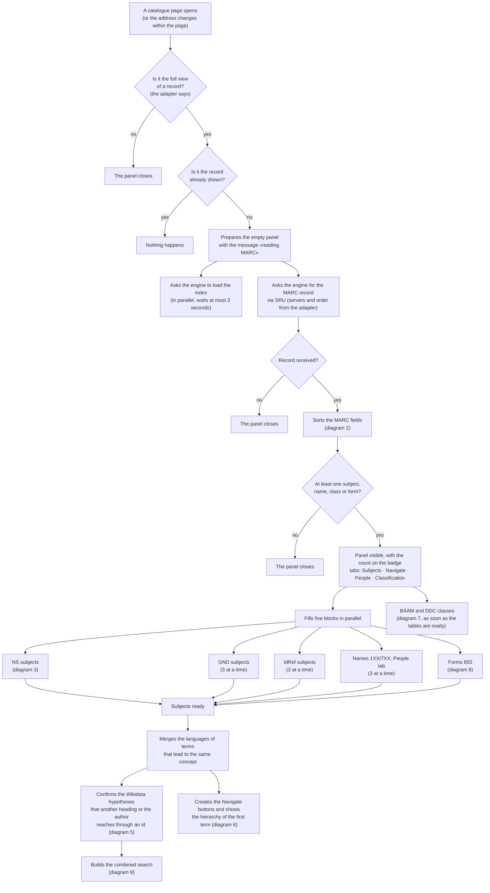
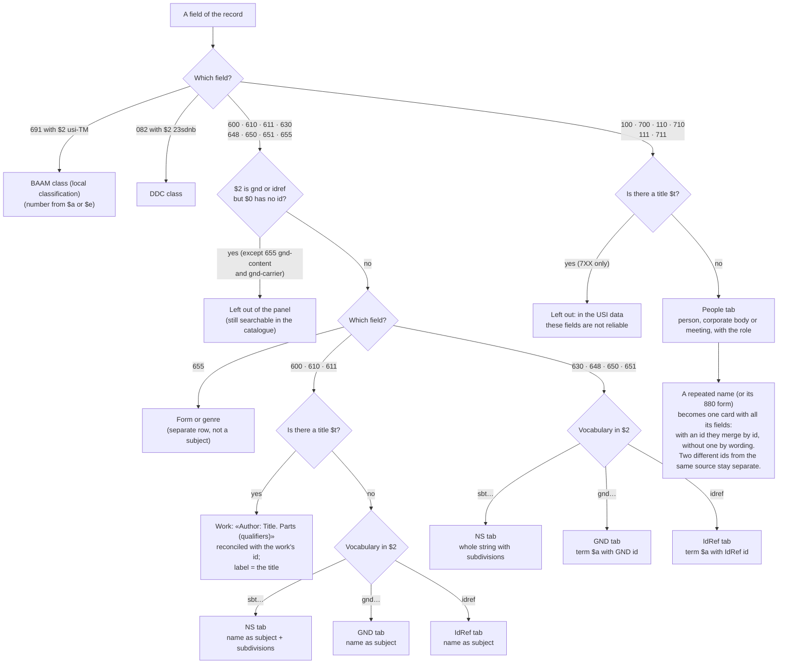
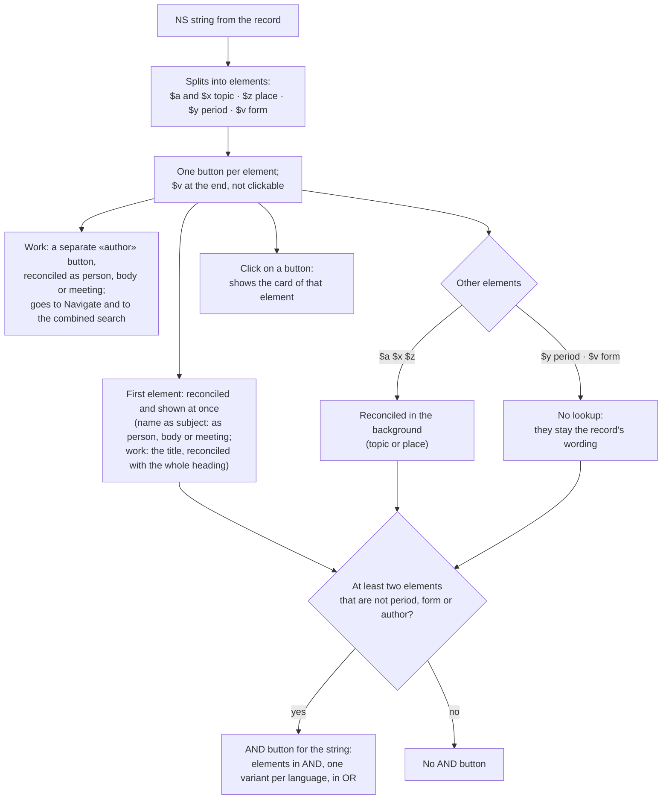
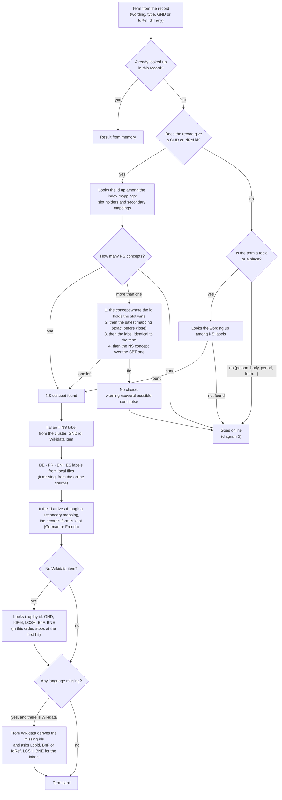
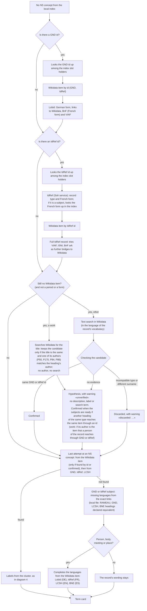
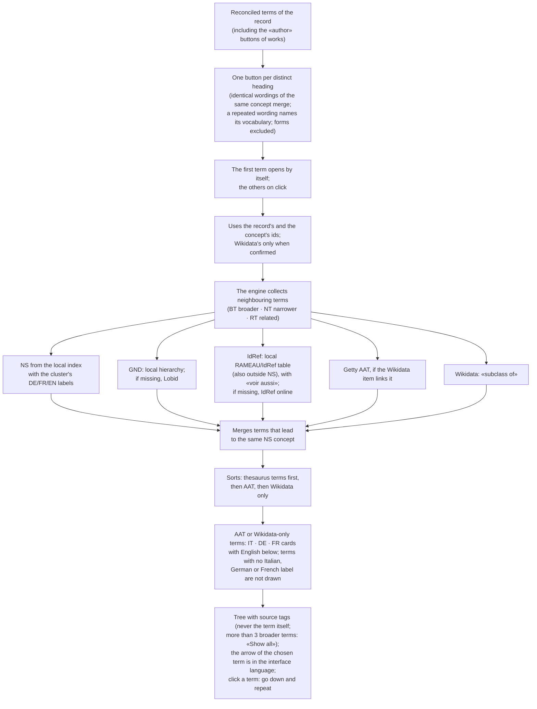
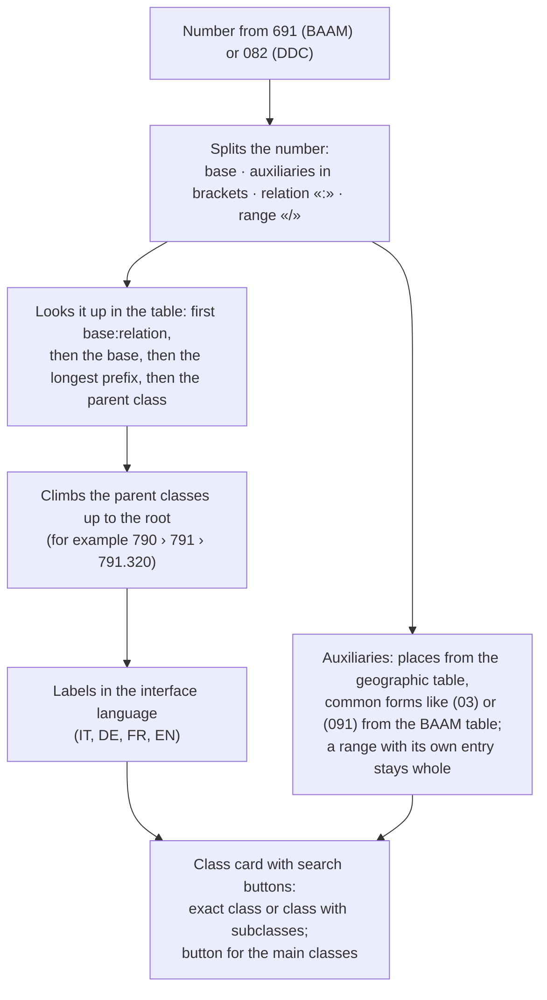
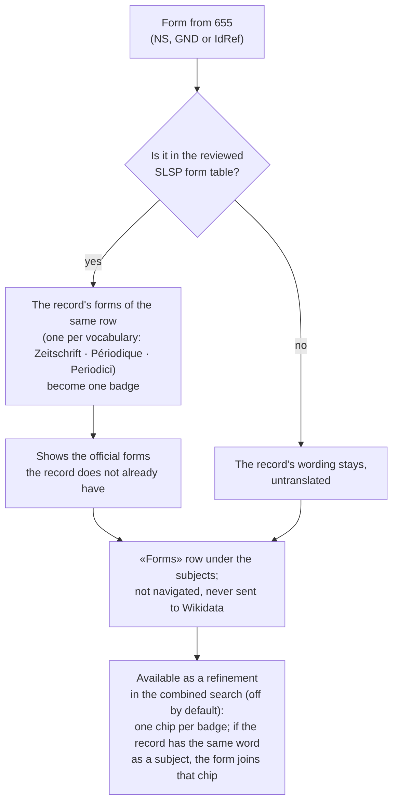
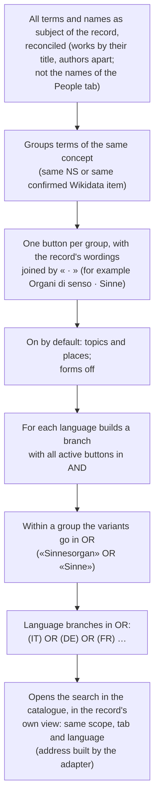

# Subject Navigator, step by step

What happens from the moment a record is opened in a Primo VE catalogue (swisscovery, reperio.usi.ch, explore.lib.unige.ch) to the moment the panel shows subjects, names, works, hierarchies and classes. Version 1.0.0. Every step matches the code of this version.

## Who does what

The extension has five parts. The diagrams use these names.

- **The page.** The scripts inside the catalogue: they build the panel (in a closed shadow DOM), sort the record's fields, draw cards and buttons. They ask the engine for the stylesheet and the BAAM, DDC, place, form and role tables: the catalogue page cannot read the extension's files.
- **The site adapter.** Two files, one for the page (`cs_site.js`) and one for the engine (`bg_site.js`), with everything specific to Primo VE and Alma: how a record page is recognised, where the MARC record is asked for (SRU, allowed servers), how a search is built in the same view, with the same scope and tab, which fields to search for BAAM and DDC. A test checks that no other file contains any of it. For another catalogue, these two are rewritten.
- **The engine.** The extension's service worker: it keeps the index in memory and runs every lookup, local and online. The page asks it for things by message; the engine accepts only SRU addresses of the allowed servers and follows redirects only to them.
- **The local index.** Files inside the extension: NS concepts with their mappings, DE/EN/ES labels and the GND hierarchy, one RAMEAU/IdRef table (French label, hierarchy and «voir aussi» of the thesaurus terms, with both ids), the GND and RAMEAU notes (loaded when a card first needs one), BAAM, DDC, place and form tables. Spanish labels and BNE links from the files of the BNE open-data portal. No network.
- **Online sources.** swisscovery SRU (the MARC record: the network zone first, swisscovery.ch then swisscovery.slsp.ch, then the institution), Wikidata, Lobid (GND), IdRef, BnF, LCSH, BNE, Getty AAT. Used only when the index is not enough. Wikidata SPARQL goes through QLever (University of Freiburg; query.wikidata.org when it does not answer): when a record opens, one query with all its GND and IdRef ids; when the subjects are ready, one Wikidata and one Getty query prepare the hierarchies of every Navigate term.

## 1. Overview: from opening the record to a full panel

- Every term goes through **reconciliation** (diagrams 4 and 5): the engine looks for the concept, the labels in five languages and the Wikidata item, if any. The result is kept in memory, so a repeated term is not looked up twice.
- If another record is opened while one is loading, the extension finishes the first and then moves on: no navigation is lost.
- The timing log records five moments: record start, panel visible, subjects ready, record end, navigation.

## 2. Sorting the MARC fields

Every field of the record passes through this filter, in the order it appears. 880 fields (other script) count as the field they are linked to.

- Identical fields repeated in the record are shown once.
- A field with `$2 gnd` and no id is a legacy heading: the extension does not try to guess it.
- 1XX/7XX names go only to the People tab: they do not enter the index, which holds subject terms only, nor the combined search. They also serve to confirm a work through its author.
- **Complete names.** Person: `$a`, numeration `$b`, first `$c`, then in brackets `$q`, the other `$c` and the dates. Corporate body: the `$b` levels, with `$g` in brackets; under 110/710 also the number, date and place of a meeting. Meeting: every `$c`. Place 651: also `$b`. Added parts go in brackets, so the Wikidata search always uses the bare name.
- SBT identifiers in `$0` (SBT11) lead to no other source and are not used.

## 3. NS subject strings

An NS string (for example *Architettura — Svizzera — Sec. 20.*) is split into buttons, one per element. GND and IdRef tabs have one term per field instead. A work as subject (*Carroll, Lewis. Alice's adventures in Wonderland — Illustrazioni*) gives three buttons: [title] [author: Carroll, Lewis] [Illustrazioni].

## 4. Reconciliation, part one: a term in the local index

This is the heart of the extension. For every term the engine first looks in the local index, without network. The record's identifiers (GND or IdRef in `$0`) count more than its words.

- **Slot holder**: every NS concept has one slot per vocabulary (one GND id, one RAMEAU, one IdRef…). The other ids declared for the same concept are **secondary mappings**: they reach the concept but do not take the slot.
- The IdRef slot is always the twin of the RAMEAU slot.
- A wording alone anchors only topics and places to the thesaurus: a person named like a concept does not become that concept.
- The card shows the Italian title (and the interface language), the description, the NS scope note and definition, the route (section 10), warnings and the cluster reliability dots (4 = highest).

## 5. Reconciliation, part two: when the index is not enough

This happens mostly with names, places and terms the Nuovo Soggettario does not have. Each step runs only if the previous one did not find what is needed.

- Text proposes, identifiers decide. A Wikidata item found only by text and not confirmed by an id stays a hypothesis: its link is shown (with the warning), but it does not anchor the term to a thesaurus concept, gives no labels or description, and searches use only the record's wording.
- A confirmation through the record says so on the card: «confirmed by the record» or, for a work, «confirmed by its author in the record».
- If a source does not answer in time, the card shows what it has; on a network error the error message replaces the card without blocking the other terms.

## 6. Hierarchy in the Navigate tab

## 7. BAAM and DDC classes

Everything happens in the page, with the tables inside the extension: no network. The catalogue's search fields for BAAM and DDC come from the adapter.

## 8. Forms and genres (655)

## 9. Combined search (Navigate tab, at the bottom)

## 10. Reading the route in the panel

Under each term the panel shows a row of tags: the path the engine followed, in order. During testing it tells where a result comes from.

| Tag | Meaning | Diagram |
|---|---|---|
| `ID→NS-local` | The record's id holds the slot in an NS concept. | 4 |
| `ID→NS-local(secondary)` | The record's id reaches the concept as a secondary mapping; the record's form is kept. | 4 |
| `NS-local` | Found by wording among the NS labels (no id). | 4 |
| `NS→GND` `NS→WD` `cl→WD` | GND id or Wikidata item taken from the concept's cluster. | 4, 5 |
| `GND→WD` `IdRef→WD` `LCSH→WD` `BnF→WD` `BNE→WD` `VIAF→WD` `ISNI→WD` | Wikidata item found through an id: reliable. | 4, 5 |
| `GND→NS-reverse` `IdRef→NS-direct` | Concept found from the id outside the first lookup (for example after an ambiguity resolved elsewhere). | 5 |
| `Lobid:…` `Lobid→WD` `Lobid→BnF` | GND record read online, with its links. | 5 |
| `IdRefSolr:… (type)` `IdRef:…` `IdRef→FR→NS` | IdRef record read online; the last one means the concept was found through the French form. | 5 |
| `coref:VIAF+ISNI…` | Ids of other sources taken from the IdRef record to look for Wikidata. | 5 |
| `WD-text` | Text search in Wikidata (for works: title plus author): see the warning below it (confirmed, unverified, confirmed by the record). | 5 |
| `WD-text✗` | The candidate found by text was discarded. | 5 |
| `NS-reverse` | NS concept found at the end, starting from Wikidata or from an id. | 5 |
| `exact-links` | GND or IdRef subject without NS concept: languages from the headings the sources declare equivalent (exactMatch), no network. | 5 |
| `enrich-person` `enrich-place` … | Name or place without NS concept: languages completed from the sources linked to Wikidata. | 5 |

---

Subject Navigator 1.0.0 · index built from the October 2026 dumps.
