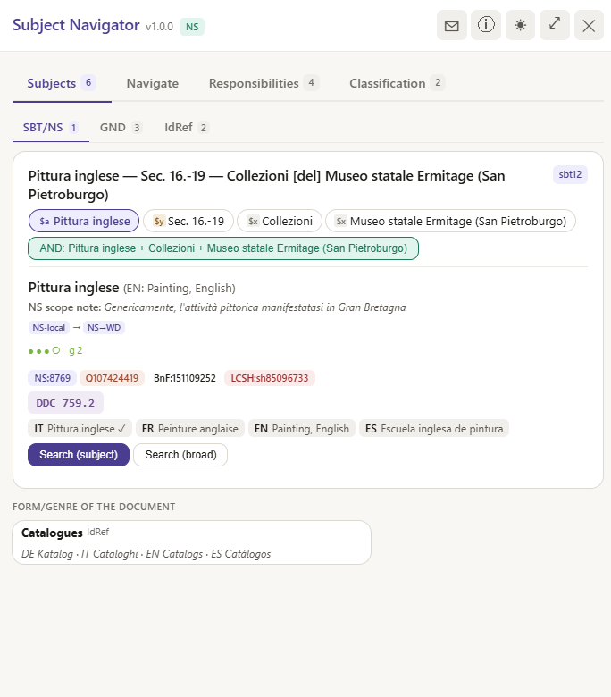
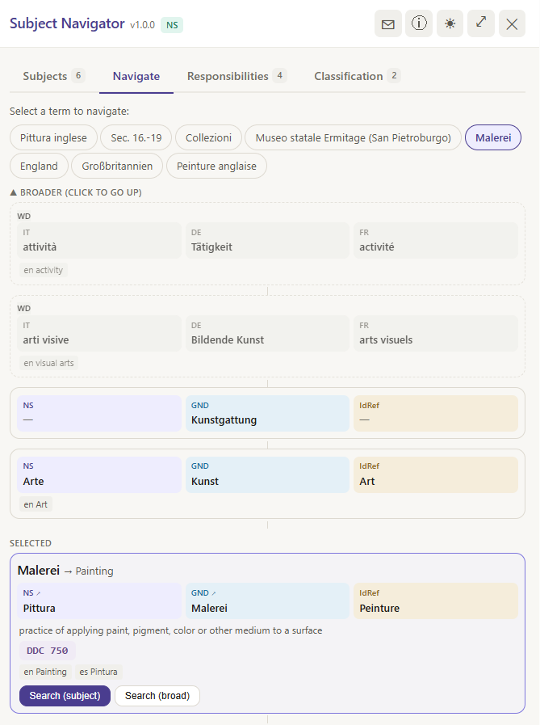

# Subject Navigator

A Chrome extension for library catalogues built on Primo VE / Alma. On a
record page it opens a side panel that reads the record's MARC data and shows
its subject headings across vocabularies and languages: Nuovo soggettario
(BNCF), GND, RAMEAU / IdRef, LCSH and BNE. From the panel you can browse the
hierarchies of a subject and search the catalogue with the headings of the
record, in every language at once.

  
  

## Catalogues

- [swisscovery](https://swisscovery.ch) (SLSP), all institution views
- [reperio.usi.ch](https://reperio.usi.ch) (Università della Svizzera italiana)
- [explore.lib.unige.ch](https://explore.lib.unige.ch) (Université de Genève)

The panel follows the catalogue's interface language (Italian, German,
French, English) and runs only on record detail pages.

## Install

The extension is not in the Chrome Web Store: it is installed from the
release zip.

1. Download `subject-navigator-<version>.zip` from the
   [Releases](https://github.com/MicheleStefani/subjectnavigator/releases)
   page and unzip it.
2. Open `chrome://extensions` and switch on **Developer mode** (top right).
3. Click **Load unpacked** and choose the unzipped `subject-navigator-<version>`
   folder.
4. Open a record in one of the catalogues above: the panel appears on the
   right.

To update, remove the old version and load the new folder the same way.
Downloading the repository itself is not enough: the authority index is
not in the repository, only in the release zip (or rebuilt, see below).

## What the panel shows

- **Subjects** — every subject heading of the record, matched across the
  vocabularies by their identifiers (through a local index and Wikidata),
  with the equivalent headings in Italian, German, French, English and
  Spanish, notes and links to the authority records. Names, corporate
  bodies, meetings and works (author/title headings) used as subjects are
  shown with their parts and their authority identifiers.
- **Navigate** — broader, narrower and related terms of a heading, from the
  thesauri and, where they have none, from Wikidata and the Getty AAT.
- **Search** — the catalogue searched with one heading or a combination of
  headings, each in all its languages; the search opens in the same view,
  with the same scope, as the record.
- **Classification** — the numbers of the record in the BAAM local
  classification (Library of the Academy of Architecture, USI, Mendrisio;
  its notation is partly derived from UDC) and in DDC, with their captions
  and hierarchy, and a search by class.
- **People** — the record's authors and contributors with their roles.

Equivalences are decided only by authority identifiers: a match found by
text alone is shown as a hypothesis and never used to translate or search.

## Data and licences

The code is under the [MIT licence](LICENSE). The data comes from the
authority files of BNCF, DNB, BnF / ABES, Library of Congress, BNE,
Wikidata and the Getty Research Institute, each under its own licence:
see [DATA_LICENSES.md](DATA_LICENSES.md).

## Privacy

The extension collects no personal data. To enrich a record it sends the
record's subject terms and authority identifiers to the public services
listed in [PRIVACY.md](PRIVACY.md).

## Rebuilding the index

The index is built from public dumps of the authority files with the
generator in `authority-index/`. Anyone can rebuild it from newer dumps:
see [REBUILD.md](REBUILD.md).

## Development

- `manifest.json` — Chrome Manifest V3. The service worker
  (`background.js`, `bg_*.js`) fetches the MARC record and queries the
  authority services; the content scripts (`cs_*.js`, loaded in order)
  build the panel in a closed shadow DOM.
- `cs_site.js` and `bg_site.js` hold everything specific to Primo VE /
  Alma (page addresses, MARC via SRU, search URLs): adapting the extension
  to another catalogue starts there.
- [ARCHITECTURE.md](ARCHITECTURE.md) follows a record through the
  extension step by step, with flow diagrams.
- Tests: `node tests/run_tests.js` (extension) and
  `python authority-index/tests/test_parsers.py` (generator).
- `python scripts/make_release.py` builds the release zip.

## Feedback

Use the ✉ button in the panel, or open an
[issue](https://github.com/MicheleStefani/subjectnavigator/issues).

## Author

Michele Stefani
